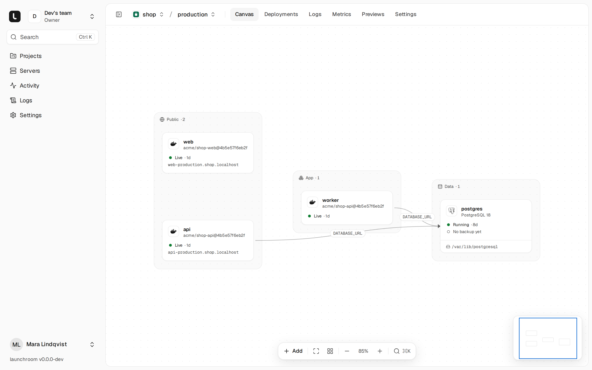

<p align="center">
  <picture>
    <source media="(prefers-color-scheme: dark)" srcset=".github/assets/logo-white.svg">
    
  </picture>
</p>

<h3 align="center">One place to deploy.</h3>

<p align="center">
  <a href="https://github.com/vantezzen/launchroom/actions/workflows/ci.yml"></a>
  <a href="https://github.com/vantezzen/launchroom/releases/latest"></a>
  <a href="LICENSE"></a>
</p>

<p align="center">
  <a href="https://launchroom.vantezzen.io">Website</a> ·
  <a href="https://launchroom.vantezzen.io/docs">Docs</a> ·
  <a href="https://launchroom.vantezzen.io/docs/getting-started/install">Install guide</a>
</p>

Everything a cloud host does for your apps, on your own server. Pick a repository, a domain and a database, and launchroom wires up the rest: it builds the app, gets the certificate, hands the app its database credentials and deploys every push without downtime. launchroom is free and open source under the MIT license, with every feature included and no account with us.

<picture>
  <source media="(prefers-color-scheme: dark)" srcset="site/public/screenshots/canvas-dark.webp">
  
</picture>

## Highlights

- **Add a server with one line.** Run the command from the dashboard on another machine and it joins. Servers connect over a private network on their own: no SSH keys, no ports to open.
- **Your computer at home builds, your VPS serves.** A machine behind your router can be a build server; launchroom routes builds to it and ships the images to the servers that run them.
- **Drop in a database.** Add Postgres, MySQL, Redis/Valkey, MongoDB or ClickHouse to the canvas and it is connected: credentials, private network path and startup order are set up for you. Backups go to your own S3 storage, with point-in-time recovery for Postgres.
- **A preview for every pull request.** Each pull request gets its own address and its own database, and the link is posted in the pull request.
- **Every server on one screen.** See each server's load, which service takes how much CPU and memory, and how the servers are connected.
- **Builds without a Dockerfile.** Next.js, Laravel, Django, FastAPI, Node servers, static sites and more are detected and built; a repository Dockerfile is used when there is one.
- **Releases you can undo.** Health-checked rollouts, instant rollback, staged changes, environments and Compare & promote from staging to production.
- **Your server stays yours.** launchroom keeps to one folder, never logs into your servers and keeps your apps running when the dashboard is down.

Also included: HTTPS on every domain, encrypted variables, logs, metrics and alerts, teams and 2FA, templates and Compose import, `launchroom.json` config as code, a public API and the `launchroom` CLI.

## Install

On a Linux server with Docker Engine 24 or newer and the compose plugin (the installer installs Docker with Docker's official script if it's missing):

```bash
curl -fsSL https://launchroom.vantezzen.io/install | sh -s -- --domain dash.example.com
```

The [install guide](https://launchroom.vantezzen.io/docs/getting-started/install) covers requirements, DNS and your first deploy. Then [add a server](https://launchroom.vantezzen.io/docs/servers/add-a-server) or [deploy your first app](https://launchroom.vantezzen.io/docs/getting-started/first-deploy).

More servers join with one line: Linux machines (x86_64 or arm64), and Macs with OrbStack, Docker Desktop or Colima. A Mac builds for every server, x86 included, and with OrbStack or Colima it can run apps too ([macOS guide](https://launchroom.vantezzen.io/docs/servers/macos)).

### Verify the release

The installer downloads the release bundle and refuses it unless its cosign signature verifies (keyless, issuer `https://token.actions.githubusercontent.com`, identity `https://github.com/vantezzen/launchroom/.github/workflows/release.yml@refs/tags/v<version>`). The same identity is pinned for later self-updates. To check a bundle by hand:

```bash
cosign verify-blob --bundle launchroom-deploy.tar.gz.sigstore.json \
  --certificate-identity https://github.com/vantezzen/launchroom/.github/workflows/release.yml@refs/tags/v0.1.0 \
  --certificate-oidc-issuer https://token.actions.githubusercontent.com launchroom-deploy.tar.gz
```

Updates run from Settings → Updates in the dashboard ([updates guide](https://launchroom.vantezzen.io/docs/operations/updates)).

## Documentation

- User docs: [launchroom.vantezzen.io/docs](https://launchroom.vantezzen.io/docs) (servers, projects, builds, databases, observability, security, API and CLI)
- Design docs and decision log for contributors: [`docs/`](docs/README.md)

## Develop

Everything runs in Docker; the host needs Docker and `make`.

```bash
make up     # start the dev stack
make help   # list all tasks
```

Repository layout:

- `dashboard/`: control plane (Laravel + Inertia/React)
- `daemon/`: `launchroomd`, the per-server daemon, plus `dockerd-guard` and the ambassador (Go)
- `cli/`: the `launchroom` CLI (Go)
- `protocol/`: dashboard ↔ daemon contract (JSON Schemas, signing spec)
- `packages/`: JS packages (`@vantezzen/launchroom-next-adapter`)
- `deploy/`: install bundles, install scripts and images
- `site/`: website and user docs
- `dev/`: local development environment
- `docs/`: design docs and decision log

## Contributing

Read [CONTRIBUTING.md](CONTRIBUTING.md) to get started and [AGENTS.md](AGENTS.md) for the rules every change follows.

## Security

Report vulnerabilities privately as described in [SECURITY.md](SECURITY.md).

## License

[MIT](LICENSE)
